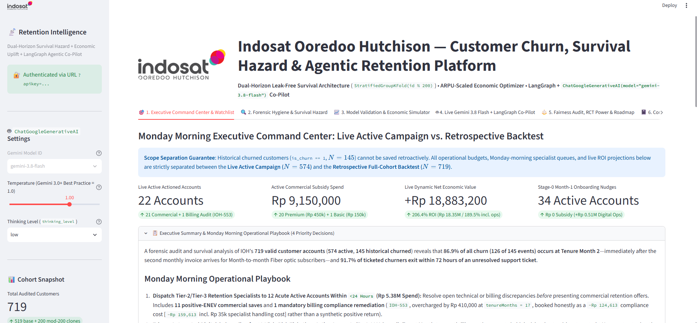
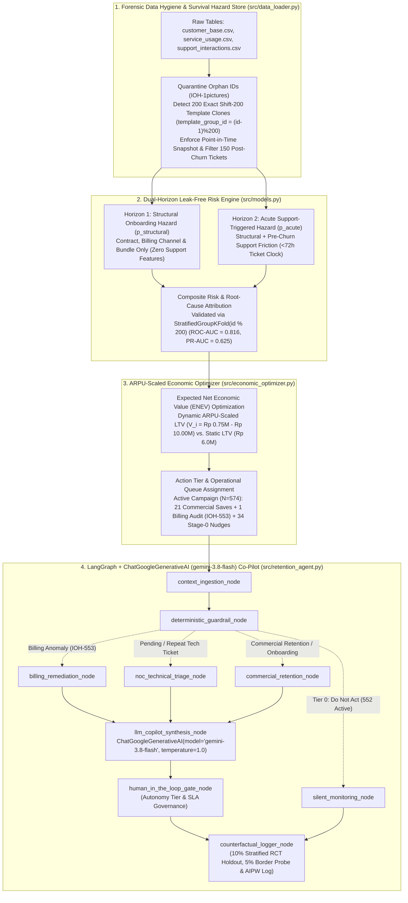

# IOH Customer Churn, Survival Hazard & Agentic Retention Intelligence



An end-to-end **Data Science, Survival Hazard, Economic Uplift, and LangGraph / `ChatGoogleGenerativeAI` (`gemini-3.8-flash`) Agentic Retention** platform built for the **Indosat Ooredoo Hutchison (IOH) Data Scientist Technical Assessment**.

Rather than treating customer churn solely as a static binary classification problem, this repository decouples **leak-free Dual-Horizon survival & acute risk estimation** from **ARPU-scaled Expected Net Economic Value (ENEV) optimization**, and operationalizes the resulting intelligence through a deterministic-first, human-governed **LangGraph `StateGraph`** and an interactive **Streamlit Co-Pilot Application** ([`streamlit_app.py`](streamlit_app.py)).

---

## Architecture & End-to-End Workflow



---

## Key Analytical Findings & Design Highlights

### 1. Forensic Data Hygiene & Survival Hazard Analysis ([`src/data_loader.py`](src/data_loader.py))
- **Orphan Primary Key Quarantine**: Identifies and quarantines corrupted customer ID `IOH-1pictures` across all three raw tables (`720` raw rows $\rightarrow$ **`719` valid customers**: `574` active, `145` churned), logging all quarantined rows to [`outputs/quarantined_records.csv`](outputs/quarantined_records.csv).
- **Modulo-200 Synthetic Template Duplication Audit**: Customers `IOH-001..IOH-200` and `IOH-201..IOH-400` share **100% identical** `region`, `contractType`, `tenureMonths`, `monthlyCharges`, `totalCharges`, and `churnLabel`, with `yearMonth` shifted by `+1 month` and ticket timestamps shifted by **`+30 days`**. We assign every record to `template_group_id = (customer_num - 1) % 200` (`200` unique groups) so no template clone ever crosses train/test folds.
- **Point-in-Time (PIT) Cutoffs & Post-Churn Ticket Filtering**: Filters out **`150` of `748` support interactions (`20.1%`) across `113` churned customers** that occurred after `churnDate` (`interactionDate > churnDate`), preventing future-event target leakage.
- **Billing Ledger Discrepancy Detection (`IOH-553`)**: Imputes `35` blank `totalCharges` records where `tenureMonths == 1` and flags active Jakarta DSL customer `IOH-553` (`tenureMonths = 8`, `monthlyCharges = Rp 205,000`) for a verified **`+Rp 410,000` ledger overcharge** (`Rp 2,050,000` billed vs. `Rp 1,640,000` expected).
- **Discrete-Time Survival Hazard & The Month-2 Churn Cliff**: Month 1 exhibits **`0.0%` churn (`0/35`)** due to initial billing cycle mechanics, followed by a **`46.7%` discrete-time hazard spike at Month 2 (`14/30`, and `60.9%` on Month-to-Month)** (`Kaplan-Meier S(2) = 53.3%`, `S(6) = 21.1%`). This motivates our **Stage-0 Pre-Second-Bill Onboarding Program** targeting all **`34` active Month-1 Month-to-Month subscribers** at `Rp 0` subsidy cost.

### 2. Dual-Horizon Leak-Free Risk Engine ([`src/models.py`](src/models.py))
- **4-Scheme Cross-Validation Audit**:
  1. **Modulo-200 `StratifiedGroupKFold(n_splits=5, group = (id - 1) % 200)` (Primary Benchmark)**: Preserves exact `20.2%` fold base rates while preventing template-clone leakage, achieving **`0.816` ROC-AUC**, **`0.625` PR-AUC (`3.10x` lift)**, and **`0.123` Brier score**.
  2. **Unstratified `GroupKFold(n_splits=5, group = (id - 1) % 200)`**: **`0.814` ROC-AUC**, **`0.622` PR-AUC**.
  3. **Contiguous `ID-Block` 5-Fold CV**: **`0.834` ROC-AUC**, **`0.654` PR-AUC**.
  4. **Naive Random `StratifiedKFold`**: Inflates ROC-AUC to **`0.880`** (**`+0.064` synthetic clone-leakage optimism**).
- **Dual-Horizon Architecture**:
  - **Horizon 1 (`p_structural`)**: Scored at Day 1 onboarding using only contract, payment method, internet/phone bundle, ARPU, and region (**zero ticket features**), achieving **`0.785` `StratifiedGroupKFold` ROC-AUC**.
  - **Horizon 2 (`p_acute`)**: Triggered when a support interaction is logged (`n_tickets`, `n_pending`, `has_repeat_ticket`), lifting `StratifiedGroupKFold` ROC-AUC to **`0.816`** and Top-Decile Lift to **`3.79x`**.

### 3. ARPU-Scaled Economic Optimizer ([`src/economic_optimizer.py`](src/economic_optimizer.py))
- **Dynamic ARPU-Scaled LTV ($V_i$)**: Scales customer lifetime value by individual monthly revenue and a `65%` contribution margin over an expected 18-month post-save retention horizon discounted at `1%/month` ($V_i$ ranges from **`Rp 749,333`** to **`Rp 9,991,103`**, cohort mean **`Rp 4,581,273`**).
- **Strict Separation of Live Active Campaign (`N = 574`) vs. Retrospective Backtest (`N = 719`)**:
  - **Live Active Campaign (`N = 574` unchurned accounts)**: Targets **`22` active accounts** = **`21` positive-ENEV commercial saves** (`17` Premium `Rp 450k` + `4` Basic `Rp 150k`) + **`1` mandatory billing compliance remediation (`IOH-553`)**, requiring **`Rp 8,250,000`** total budget to generate **`Rp 22,443,977`** gross saved LTV and **`+Rp 14,193,977` net economic value (`2.72x Gross ROI / +1.72x Net ROI`)**, plus **`34` Stage-0 Pre-Second-Bill onboarding nudges (`Rp 0` subsidy)**.
  - **Retrospective Full-Cohort Backtest (`N = 719`)**: Actions **`65` accounts** (`45` Premium + `19` Basic + `1` Billing Audit) for **`Rp 23,250,000`** spend and **`+Rp 39,237,384` net economic value (`2.69x Gross ROI / +1.69x Net ROI`)**.

### 4. LangGraph + `ChatGoogleGenerativeAI` (`gemini-3.8-flash`) Co-Pilot ([`src/retention_agent.py`](src/retention_agent.py))
- **LLM Integration via `langchain-google-genai`**:
  - Instantiates `ChatGoogleGenerativeAI(model="gemini-3.8-flash", temperature=1.0)` via `create_gemini_chat_model()` in [`src/retention_agent.py`](src/retention_agent.py).
  - Supports both **Gemini Enterprise Agent Platform (Vertex AI)** (`GOOGLE_GENAI_USE_VERTEXAI=true`, `GOOGLE_CLOUD_PROJECT`, `GOOGLE_CLOUD_LOCATION`) and **Gemini Developer API** (`GOOGLE_API_KEY` / `GEMINI_API_KEY`) configured via `.env`.
  - Uses `.text` extraction (`extract_gemini_text()`) for Gemini 3+ content blocks (`extras.signature`), JSON Schema structured output (`with_structured_output(schema=CopilotSynthesisOutput.model_json_schema(), method="json_schema")`), and native tool binding (`llm.bind_tools(AUTHORIZED_RETENTION_TOOLS)`).
- **Powered Counterfactual Evaluation**: Implements a **10% SHA-256 above-threshold RCT holdout** (`20%` initial 90-day calibration option) paired with a **5% below-threshold border/Month-1 diagnostic probe**, cutting required sample sizes in half (`580` targeted accounts for Premium `50% -> 25%` uplift at `80%` power).

---

## Interactive Streamlit App & URL API Key Security ([`streamlit_app.py`](streamlit_app.py))

The platform includes a 6-tab interactive Streamlit application ([`streamlit_app.py`](streamlit_app.py)) featuring the full notebook report, executive command center, economic simulator, and live `ChatGoogleGenerativeAI(model="gemini-3.8-flash")` LangGraph execution with specialist tool-calling chat.


### URL Query-Parameter Authentication (`?apikey=API_KEY`)
By design, [`streamlit_app.py`](streamlit_app.py) can **ONLY be accessed by passing the valid `API_KEY` (stored in `.env`) in the URL query string**:

```text
https://example-url.streamlit.app?apikey=API_KEY
http://localhost:8501/?apikey=API_KEY
```

Requests without `?apikey=...` or with an invalid key are immediately blocked with HTTP 401 / `st.stop()` using constant-time `hmac.compare_digest` verification.

---

## Quick Start & Makefile Usage

### 1. Install Dependencies
```bash
make install
# Or directly:
uv pip install -r requirements.txt
```

### 2. Configure `.env` & Streamlit `.toml` Secrets
Copy `.env.example` to `.env` and generate `.streamlit/secrets.toml` (plus optional GCP `service-account.json` key):
```env
GOOGLE_GENAI_USE_VERTEXAI=true
GOOGLE_CLOUD_PROJECT=your-project-id
GOOGLE_CLOUD_LOCATION=global
GEMINI_MODEL=gemini-3.8-flash
API_KEY=your_generated_api_key
```

To generate `.streamlit/secrets.toml` (and optionally create/download a GCP Service Account JSON key via `gcloud`):
```bash
# Generate .streamlit/secrets.toml and secrets.toml from .env (and service-account.json if present)
python generate_service_account_secrets.py

# Or provision a new GCP Service Account key via gcloud and embed [gcp_service_account] into secrets.toml
python generate_service_account_secrets.py --create-gcp-key
```

### 3. Launch the Streamlit Application (`make run` / `make streamlit`)
```bash
make run
# Or directly:
streamlit run streamlit_app.py
```
Then open the authenticated URL in your browser using the `API_KEY` from `.env`:
```text
http://localhost:8501/?apikey=<YOUR_API_KEY>
```

### 4. Run the Full Analytical Pipeline (`make pipeline`)
```bash
make pipeline
# Or directly:
python main.py
```

---

## Repository Structure

```text
indosat-technical-test/
├── streamlit_app.py                                # Interactive Streamlit App (requires ?apikey=API_KEY)
├── makefile                                        # Make targets: run, app, streamlit, pipeline, test, zip
├── main.py                                         # End-to-end 10-stage pipeline orchestrator
├── .env                                            # Environment configuration & API_KEY
├── .env.example                                    # Environment template
├── IOH_Customer_Retention_Intelligence.ipynb       # Executed narrative Jupyter Notebook deliverable
├── retention_intelligence.ipynb                    # Synchronized executed notebook copy
├── IOH_Executive_Presentation.pptx                 # 12-slide Executive Presentation deck
├── requirements.txt                                # Python package dependencies
├── src/                                            # Core modular Python package
│   ├── __init__.py
│   ├── data_loader.py                              # Forensic data hygiene, survival hazard & PIT features
│   ├── models.py                                   # Dual-Horizon models & 4-scheme CV audit
│   ├── economic_optimizer.py                       # ARPU-scaled LTV, ENEV optimizer & Pareto frontier
│   ├── retention_agent.py                          # LangGraph StateGraph & ChatGoogleGenerativeAI (gemini-3.8-flash)
│   └── figures.py                                  # Publication-grade 8-figure suite generator
├── figures/                                        # High-resolution diagnostic & architectural charts (fig1..fig8)
├── img/                                            # Brand logo & Streamlit UI screenshots (Indosat_Ooredoo_Hutchison.png, streamlit-home.png)
└── outputs/                                        # 17 exported CSVs, JSON contracts & Mermaid graph
```
